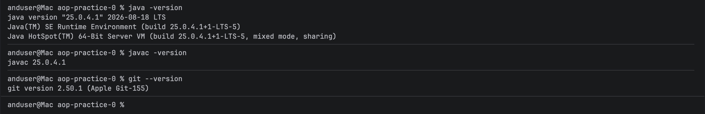
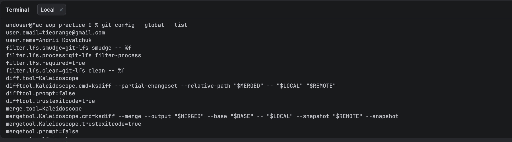
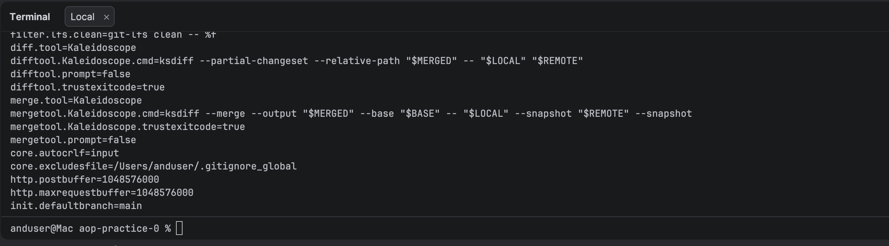
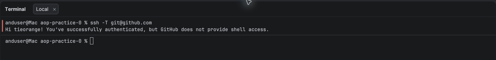
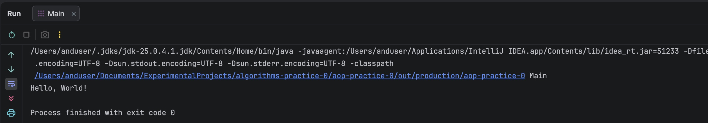
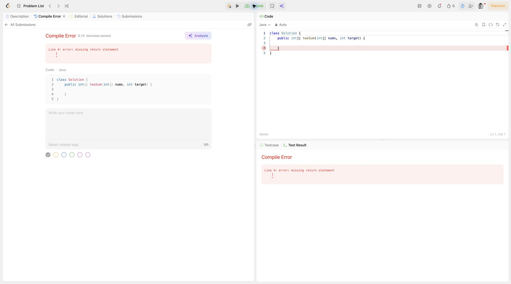
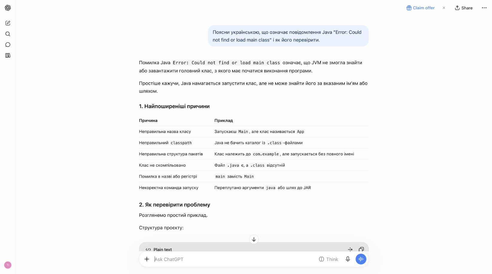

# Практичне заняття № 0 — Підготовка робочого середовища Java

- **Студент:** Ковальчук Андрій Олегович
- **Група:** ЧСБ24F301ДОФ26
- **Спеціальність:** Комп'ютерні науки
- **Дисципліна:** Алгоритмізація та основи програмування

## Облікові записи

- [GitHub — tieorange](https://github.com/tieorange)
- [LeetCode — tieorange](https://leetcode.com/u/tieorange/)
- [HackerRank — tieorange](https://www.hackerrank.com/profile/tieorange)

У GitHub підтверджено адресу пошти й увімкнено двофакторну автентифікацію. Профіль LeetCode пов'язаний із GitHub; Java зберігається як вибрана мова редактора й на іншій задачі.

## Перевірка середовища

На macOS ARM64 встановлено Oracle JDK 25.0.4.1. Для цього репозиторію версію вибрано через `jenv` у файлі `.java-version`; глобально збережено OpenJDK 17 для Flutter та Android.

Термінал iTerm2 встановлено; оболонка — `/bin/zsh`. Команди `whoami` і `pwd` працюють.

```text
$ java -version
java version "25.0.4.1" 2026-08-18 LTS
Java(TM) SE Runtime Environment (build 25.0.4.1+1-LTS-5)
Java HotSpot(TM) 64-Bit Server VM (build 25.0.4.1+1-LTS-5, mixed mode, sharing)

$ javac -version
javac 25.0.4.1

$ git --version
git version 2.50.1 (Apple Git-155)

$ ssh -T git@github.com
Hi tieorange! You've successfully authenticated, but GitHub does not provide shell access.
```

У глобальних налаштуваннях Git задано `user.name=Andrii Kovalchuk` та `user.email=tieorange@gmail.com`. Закритий SSH-ключ не зберігається в репозиторії.

Публічний репозиторій клоновано в IntelliJ IDEA через SSH. Остаточне оновлення звіту зафіксовано і надіслано через інтерфейс Git в IntelliJ IDEA.

## Перша Java-програма

Файл [`src/Main.java`](src/Main.java) скомпільовано і запущено в IntelliJ IDEA з Oracle JDK 25. Панель Run показала `Hello, World!` і `Process finished with exit code 0`. Результат:

```text
Hello, World!
```

## Перевірка навчальних платформ

- **LeetCode:** у задачі [Two Sum](https://leetcode.com/problems/two-sum/) вибрано Java; запуск початкового шаблону дав очікувану помилку компіляції, яка підтверджує роботу платформи. Пробну спробу надіслано.
- **HackerRank:** задачу [Welcome to Java!](https://www.hackerrank.com/challenges/welcome-to-java/submissions) прийнято з результатом 3 бали. У профілі вказано Європейський університет, Черкаська філія, ступінь бакалавра за спеціальністю Computer Science і навчання з вересня 2026 року. На момент виконання перша зірка в розділі Java вимагала 25 балів, тому одна вступна задача зірки не дає. Позначка `Java 7` на знімку стосується компілятора HackerRank, а не JDK, встановленого на комп'ютері.
- **ChatGPT:** обліковий запис активний; сервіс відповів на навчальний запит про помилку `Could not find or load main class`.
- **Claude:** вебобліковий запис активний, план Free. Команда `claude --version` показує `2.1.205`, але тариф Free не включає використання Claude Code. Платну підписку не оформлено.

## Ускладнення

- Наявний SSH-ключ не був прив'язаний до GitHub. Після додавання відкритого ключа й підтвердження входу перевірка `ssh -T` стала успішною.
- Методичка очікує першу зірку за `Welcome to Java!`, проте поточні правила HackerRank дають за неї 3 з потрібних 25 балів.

## Знімки екрана

### Версії Java та Git



### Параметри автора Git

Повний вивід команди `git config --global --list` показано у двох кадрах через висоту вікна термінала.





### SSH-з'єднання з GitHub



### Запуск Java-програми в IntelliJ IDEA



### Перевірка LeetCode



### Розв'язана задача HackerRank


### Відповідь ChatGPT


